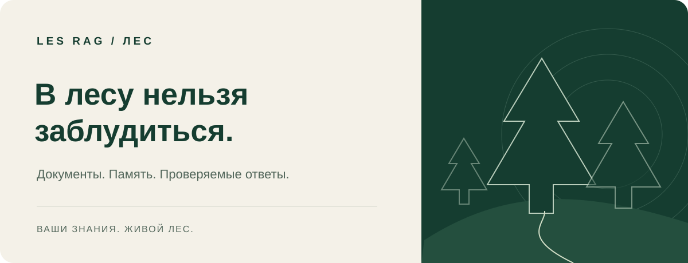
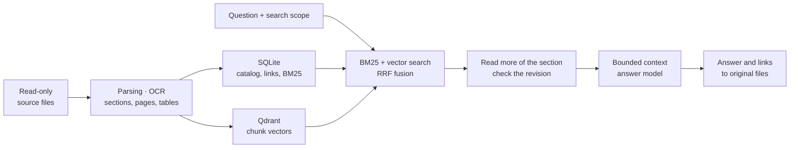
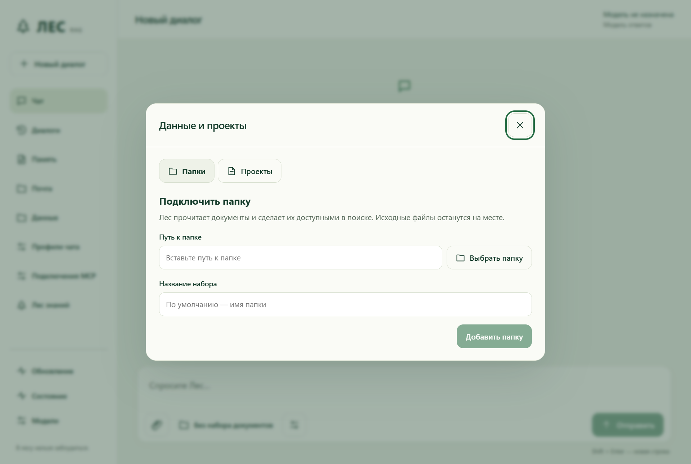

<strong>Your documents. Answers with sources.</strong>

<a href="README.md">Русский</a> · <a href="https://github.com/proovcme/LES/releases/latest/download/LES-RAG-Web-Setup.exe"><strong>Download for Windows</strong></a> · <a href="USER_GUIDE.md">User guide (Russian)</a>

LES RAG is a desktop app for searching and chatting with your documents. Connect a model, choose a folder in File Explorer, and ask a question. From an answer, you can open the source document at the relevant page.

## RAG architecture

1. **Indexing.** A background job parses documents and runs OCR when needed. Chunks retain links to their section, page, or sheet. The catalog and index live separately from the source folders. A publication journal helps recover interrupted updates.
2. **Retrieval.** SQLite BM25 finds terms and identifiers; Qdrant finds semantic matches. Reciprocal rank fusion (RRF) combines these two rankings within the selected datasets and filters. The hierarchy separately suggests sections for navigation and further reading; it does not cast another vote or reorder global results. The default Rust chat does not yet support reranking; Qdrant Server is the default vector store.
3. **Reading and context.** LES can expand a match to its parent section and nearby chunks. The model receives a bounded context drawn from evidence, conversation history, and memory. It can read a physical PDF page by document ID.
4. **Answers and evidence.** Answers stream. Citation links are tied to the retrieved source file and revision, including the page or sheet when known. LES reports when the selected sources provide no evidence. A citation lets you verify the answer; it does not guarantee the model's conclusion.

[Ranking](docs/modules/rag-ranking.md) · [Document reading and context](docs/modules/chat-section-context.md) · [Application architecture](docs/LIGHT_ARCHITECTURE.md)

In the source candidate, MCP uses the same retrieval and source readers as chat.
An external client can retrieve context, read an original Word document or PDF
page (including scan OCR), and check its revision without invoking the LES
answer model. Continuations pin the reading-view hash; table rows remain whole.
[MCP and CLI source contract](docs/modules/native-source-mcp.md).

The source tree includes the Rho coordinator, folder watching, and adapters for Docling Word parsing and Xberg PDF tables. These changes do not automatically update the installer linked below. Overview synthesis and automatic PDF reading still need fixes. [Current status and limitations](docs/SEPARATION.md).

## Install and use

- **Windows x64.** [Web and offline installers](https://github.com/proovcme/LES/releases/latest), [terminal setup and commands](docs/public/les-light/README.md#установка). Installing WebView2 requires internet access if it is not already present. The installer is unsigned.
- **Models.** Connect local Ollama or an OpenAI-compatible API. Assign the answer and embedding models separately. Docker is not required.
- **Desktop.** The Windows app uses a Svelte chat, Rust API, and Rust background services. It bundles Python solely to run external skills offline. Projects, memory, chat profiles, MCP connections, and updates are available from the app.
- **Integrations.** [MCP, API, and CLI](docs/public/les-light/README.md#для-интеграций) · [macOS preview](docs/MACOS_PREVIEW.md) · [Limitations and backlog](docs/BACKLOG.md) · [License](LICENSE).

[Knowledge Forest — an interactive document map](assets/screenshots/forest-835.jpg)
