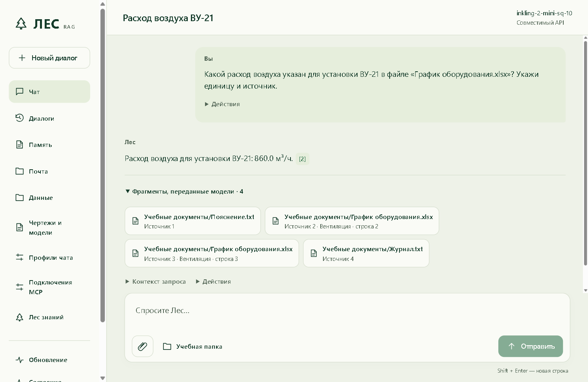
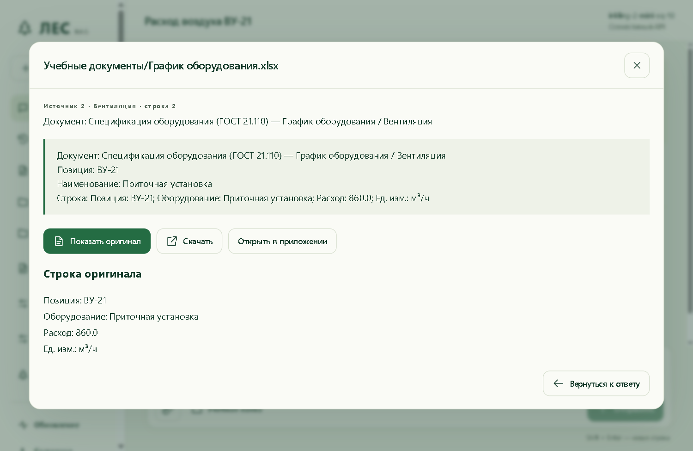
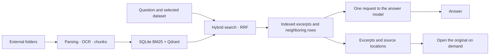

<strong>Your documents. Answers with sources.</strong>

<a href="README.md">Русский</a> · <a href="https://github.com/proovcme/LES/releases"><strong>Download for Windows</strong></a> · <a href="USER_GUIDE.md">User guide (Russian)</a>

LES RAG is a desktop app for searching and chatting with your documents. Connect a model, choose a folder in File Explorer, and ask a question. From an answer, you can open the source document at the relevant page.

## Chat and sources

In this demo folder, LES finds an airflow value in a spreadsheet. Below the
answer, you can see the excerpts sent to the model and a link to row 2 on the
Ventilation sheet.

Open the citation to see the same row in the original workbook.

## How search works

LES watches external folders and updates its index. For a question about a
dataset, LES retrieves indexed excerpts, adds nearby passages or table rows
when needed, and sends a bounded context to the model. Below the answer, you can
see the excerpts the model received and open source pages, sheets, or rows.

Explicit document reading can open the original. API, CLI, and MCP use shared
retrieval and can return sources without calling the answer model.

[Application architecture](docs/LIGHT_ARCHITECTURE.md) · [Retrieval and RRF](docs/modules/rag-ranking.md) · [Source API and MCP](docs/modules/native-source-mcp.md) · [Release history](docs/RELEASE_LEDGER.md)

## Install and use

- **Windows x64.** [Web and offline installers](https://github.com/proovcme/LES/releases), [terminal setup and commands](docs/public/les-light/README.md#установка). Installing WebView2 requires internet access if it is not already present. The installer is unsigned.
- **Models.** Connect local Ollama or an OpenAI-compatible API. Assign the answer and embedding models separately. Docker is not required.
- **Desktop.** The Windows app uses a Svelte chat, Rust API, and Rust background services. Windows downloads Python the first time an approved external skill script runs. Projects, memory, chat profiles, MCP connections, and updates are available from the app.
- **Integrations.** [MCP, API, and CLI](docs/public/les-light/README.md#для-интеграций) · [macOS preview](docs/MACOS_PREVIEW.md) · [Limitations and backlog](docs/BACKLOG.md) · [License](LICENSE).
