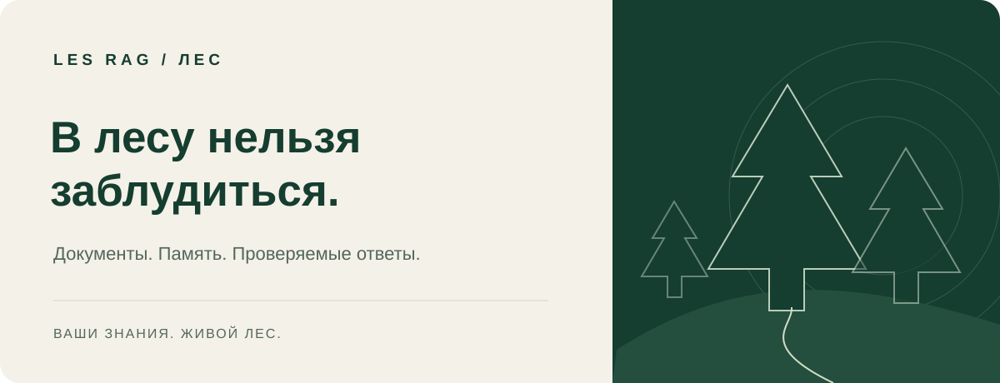
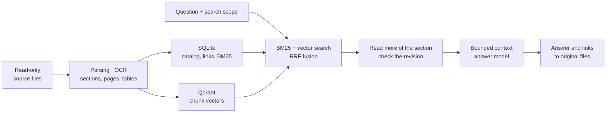
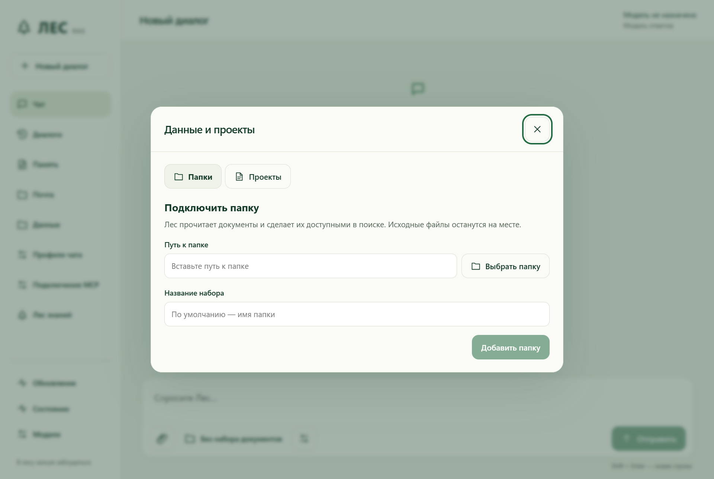

<strong>Your documents. Answers with sources.</strong>

<a href="README.md">Русский</a> · <a href="https://github.com/proovcme/LES/releases/latest/download/LES-RAG-Web-Setup.exe"><strong>Download for Windows</strong></a> · <a href="USER_GUIDE.md">User guide (Russian)</a>

LES RAG is a desktop app for searching and chatting with your documents. Connect a model, choose a folder in File Explorer, and ask a question. From an answer, you can open the source document at the relevant page.

## RAG architecture

1. **Indexing.** A background job parses documents and runs OCR when needed. Structural chunks retain headings, table captions, and links to their section, page, or sheet. The embedding model's tokenizer checks the final input limit; an oversized row requires reading the original. The catalog and index live separately from the source folders. A publication journal helps recover interrupted updates.
2. **Retrieval.** SQLite BM25 finds terms and identifiers; Qdrant finds semantic matches. Reciprocal rank fusion (RRF) combines these two rankings within the selected datasets and filters. The hierarchy separately suggests sections for navigation and further reading; it does not cast another vote or reorder global results. The selected local profile keeps BGE with reranking off. Server and Edge share the publication contract; updating the app does not automatically migrate an existing index.
3. **Reading and context.** Retrieved anchors lead to a verified Word original or physical PDF page. After reading, a shared selector removes exact duplicates and admits complete units into a bounded context. A matching paragraph number cannot inherit retrieval rank unless its content hash also matches. Partial evidence is explicitly distinguished from reading the entire dataset.
4. **Answers and evidence.** Answers stream. Citation links are tied to the retrieved source file and revision, including the page or sheet when known. LES reports when the selected sources provide no evidence. A citation lets you verify the answer; it does not guarantee the model's conclusion.

[Ranking](docs/modules/rag-ranking.md) · [Chunk structure and context selection](docs/modules/structured-search-context.md) · [Docling structure](docs/modules/canonical-document-structure.md) · [Application architecture](docs/LIGHT_ARCHITECTURE.md)

In candidate 883, Docling's DOCX structure feeds the index and source reader
directly: headings, logical cells and their spans retain their addresses.
Markdown is generated for display, without reconstructing tables from it.
Before reading, only the number of original reads is bounded; semantic
selection and the final context limit apply after reading.
PDFium reads original text; Xberg adds table structure. If that structure cannot
be verified, the original remains readable with a warning and unverified cells
cannot be used for arithmetic.
[Candidate acceptance status](docs/acceptance/canonical-rag-883.md).

In the source candidate, MCP uses the same retrieval and source readers as chat.
An external client can retrieve context, read an original Word document or PDF
page (including scan OCR), and check its revision without invoking the LES
answer model. Continuations pin the reading-view hash; table rows remain whole.
[MCP and CLI source contract](docs/modules/native-source-mcp.md).

The source tree includes the Rho coordinator, folder watching, and adapters for Docling Word parsing and Xberg PDF tables. These changes do not automatically update the installer linked below. Overview synthesis and automatic PDF reading still need fixes. [Current status and limitations](docs/SEPARATION.md).

## Install and use

- **Windows x64.** [Web and offline installers](https://github.com/proovcme/LES/releases/latest), [terminal setup and commands](docs/public/les-light/README.md#установка). Installing WebView2 requires internet access if it is not already present. The installer is unsigned.
- **Models.** Connect local Ollama or an OpenAI-compatible API. Assign the answer and embedding models separately. Docker is not required.
- **Desktop.** The Windows app uses a Svelte chat, Rust API, and Rust background services. It bundles Python solely to run external skills offline. Projects, memory, chat profiles, MCP connections, and updates are available from the app.
- **Integrations.** [MCP, API, and CLI](docs/public/les-light/README.md#для-интеграций) · [macOS preview](docs/MACOS_PREVIEW.md) · [Limitations and backlog](docs/BACKLOG.md) · [License](LICENSE).

[Knowledge Forest — an interactive document map](assets/screenshots/forest-835.jpg)
