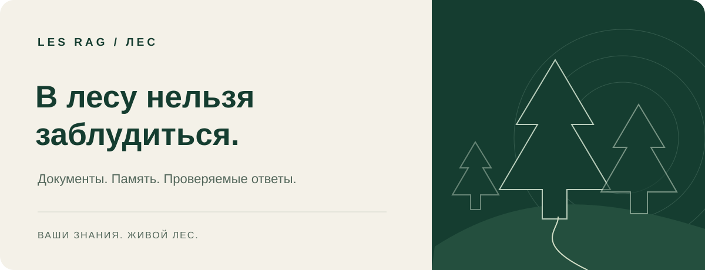
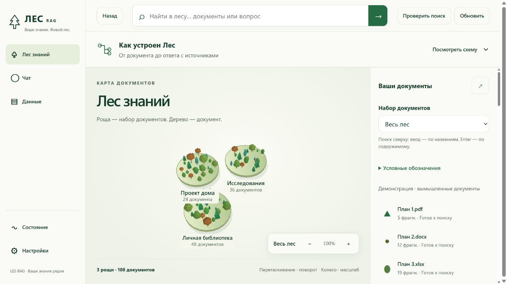
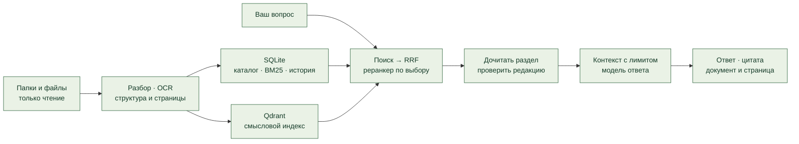

<strong>Ваши документы. Память проекта. Ответы с источниками.</strong>

<a href="https://github.com/proovcme/LES/releases/latest/download/LES-RAG-Web-Setup.exe"><strong>Скачать для Windows</strong></a> · <a href="USER_GUIDE.md">Начать работу</a> · <a href="docs/public/developer-guide.md">Разработчикам</a>

LES RAG — рабочее пространство для разговоров с ИИ и поиска по вашим документам.
Подключите модель, добавьте папку, создайте проект. Задавайте вопросы и открывайте
источник прямо из ответа.

> **Исходники — build 839. Установщик — версия 0.1.0.** Это разные состояния продукта.
> Переход приложения на Rust продолжается; Python пока остаётся в основном чате и API.
> [Что готово](docs/modules/python-exit.md) · [Что осталось](docs/BACKLOG.md) · [Проверки](docs/RELEASE_LEDGER.md).

Актуальный интерфейс build 835. Демонстрационный каталог: 3 рощи и 108
вымышленных документов; пользовательские файлы в кадре не используются.

## Больше места для разговора

Новый чат на TypeScript и Svelte оставляет больше места ответу. Поток, остановка,
вложения и выбор источников собраны вокруг одного поля ввода. Дополнительные
параметры открываются по кнопке; документы видны по понятным названиям.

Черновик сохраняется между запусками. Нормальное закрытие ждёт подтверждения
записи; если база недоступна, окно остаётся открытым с текстом и понятной ошибкой.
Два окна не могут молча затереть черновики друг друга.

Подключение папки регистрирует состав без открытия PDF и таблиц в потоке API.
Windows-наблюдатель восстанавливает окно и службы после неожиданной остановки;
причины и коды завершения остаются в журнале. [Проверки и границы 773](docs/acceptance/runtime-recovery-773.md).

Новый чат запускается отдельно с `--svelte`; основной запуск пока сохраняет прежний
интерфейс. [Что перенесено и что осталось](docs/modules/svelte-desktop.md).

## От вопроса к доказательству

Лес ищет **по словам и смыслу**, при необходимости уточняет выдачу реранкером,
дочитывает найденный раздел и укладывает материал в контекст модели.
Рядом с ответом — имя документа, цитата и доступ к оригиналу.

Действия с документом подтверждаются журналом: фраза модели «готово» сама по себе
не завершает задание. Даже сохранённое решение не означает правильность вывода.
[Проверки сохранности и интерфейса 772](docs/acceptance/safety-ui-772.md).

## Как устроен Лес

**BM25 + смысловой поиск → RRF → необязательный реранкер → чтение раздела → ограниченный контекст → ответ с источниками.**

Полноценный BM25 учитывает частоту слов и длину фрагментов. Реранкер по умолчанию
выключен. История, память и документы делят доступный контекст; ссылки в ответе
ведут к материалам, переданным модели. Обновление индекса защищено журналом восстановления.
Старт проверяет точное число фрагментов: ошибка чтения или нулевой общий счётчик
не разрешают удалять коллекцию. Полная сверка индекса по каждому файлу остаётся задачей.

Это схема продукта. Перенос выполняется по сценариям: рабочий чат пока сохраняет
прежнего координатора, а [общий Rust-кандидат](docs/modules/native-chat-turn.md)
проверяется отдельно. Режим Edge позволяет испытывать встроенный индекс без
отдельного сервера; переключение рабочего хранилища требует своей приёмки.

[Поиск и ранжирование](docs/modules/rag-ranking.md) · [Дочитывание и контекст](docs/modules/chat-section-context.md) · [Проверка BM25](docs/acceptance/bm25-index-755.md)

## Подключите один раз

**Установите → подключите модель → добавьте документы → создайте проект.**

Локальная Ollama или совместимый OpenAI API. Вы отдельно выбираете модель ответов
и модель поиска. Python и собственный Qdrant входят в установку; Docker не нужен.

## Документы на своих местах

Добавляйте файлы и папки в чат или в набор знаний. Лес показывает готовность
обработки, распознаёт сканы и следит за изменениями подключённых папок, пока открыт.
Исходники используются только для чтения; база и индекс хранятся отдельно.

## Лес помнит

У проекта — свои чаты, источники и заметки. Длинный разговор можно сжимать
в сводку, а память — просматривать, исправлять или отключать.
Память помогает продолжить работу; факты проверяются по документам.

## В лесу нельзя заблудиться

Каждое дерево — документ, каждая роща — набор знаний.
С карты можно перейти к файлам, поиску или разговору.

[Архив снимков прежнего интерфейса](assets/screenshots/README.md) сохранён для
истории проверок. Он не описывает текущую сборку или опубликованный установщик.

## Ещё возможности

OCR · чтение почты и вложений · MCP · API · CLI · проверка обновлений из GitHub.

Windows x64. Модели подключаются отдельно. Маленький установщик скачивает пакет;
при отсутствии WebView2 понадобится интернет. Установщик пока без подписи издателя.

Обработка больших таблиц остаётся экспериментальной. Качество OCR и выводы модели
нужно проверять по оригиналам. [Ограничения и бэклог](docs/BACKLOG.md).

[Руководство](USER_GUIDE.md) · [Установка из CLI](docs/public/les-light/README.md#установка) · [Выпуск 0.1.0](https://github.com/proovcme/LES/releases/tag/v0.1.0) · [Лицензия LES](LICENSE)

## macOS preview

Локальная браузерная редакция для Mac: собственный Qdrant, отдельное состояние,
OCR через Apple Vision. [Установка, зависимости и ограничения](docs/MACOS_PREVIEW.md).
Подписанный установщик для macOS пока не публиковался. Приёмка нового desktop-чата
772 выполнена на Windows; нативная macOS-сборка этим этапом не подтверждена.

В кандидате 835 проверены повтор запроса без повторного действия, сохранение ответа
при обрыве и падении, дочитывание PDF и открытие оригинала по ссылке. Настоящая
Qwen3.5:9b прошла поиск и чтение страницы на копии корпуса. Это не независимая
оценка всех ответов и не завершение переноса приложения.
[Приёмка 835](docs/acceptance/native-chat-turn-835.md).
