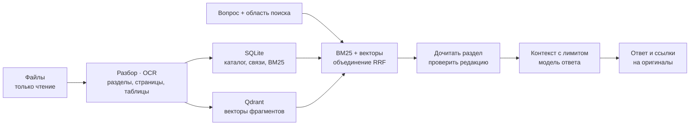
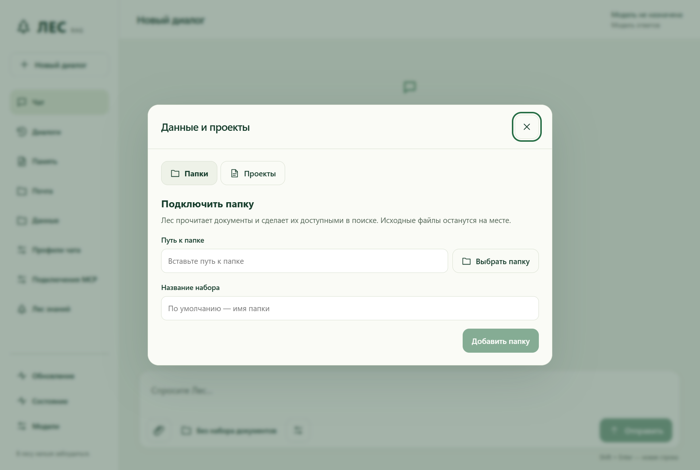

<strong>Ваши документы. Ответы с источниками.</strong>

<a href="README.en.md">English</a> · <a href="https://github.com/proovcme/LES/releases/latest/download/LES-RAG-Web-Setup.exe"><strong>Скачать для Windows</strong></a> · <a href="USER_GUIDE.md">Руководство</a>

LES RAG — настольное приложение для поиска и разговора по своим документам. Подключите модель, выберите папку в Проводнике и задайте вопрос. Из ответа можно перейти к документу и нужной странице.

## Архитектура RAG

1. **Индексация.** Фоновое задание разбирает документы и при необходимости запускает OCR. Фрагменты сохраняют связи с разделом, страницей или листом. База и индекс живут отдельно от исходных папок; журнал публикации помогает восстановить прерванное обновление.
2. **Поиск.** SQLite BM25 ищет слова и обозначения, Qdrant — смысловые совпадения. RRF объединяет эти два ранга в рамках выбранных наборов и фильтров. Иерархия отдельно предлагает разделы для навигации и дочитывания: она не меняет порядок общей выдачи повторным голосованием. Реранкер в штатном Rust-чате пока недоступен; Qdrant Server остаётся основным векторным хранилищем.
3. **Дочитывание и контекст.** Лес может поднять родительский раздел и соседние фрагменты. Модель получает ограниченный контекст из доказательств, истории и памяти. Для выбранного PDF доступно чтение физической страницы по идентификатору документа.
4. **Ответ и доказательства.** Ответ идёт потоком. Ссылки связываются с переданными источниками: файлом, редакцией и, когда известна, страницей или листом. Если поиск по выбранным материалам не дал доказательств, Лес сообщает об этом. Ссылка помогает проверить ответ, но сама по себе не подтверждает вывод модели.

[Ранжирование](docs/modules/rag-ranking.md) · [Дочитывание и контекст](docs/modules/chat-section-context.md) · [Архитектура приложения](docs/LIGHT_ARCHITECTURE.md)

В кандидате MCP использует тот же поиск и читатель источников, что и чат.
Внешний клиент может получить фрагменты, дочитать документ или страницу PDF
и проверить редакцию без вызова модели ответов Леса.
[Договор источников MCP и CLI](docs/modules/native-source-mcp.md).

Ветка разработки содержит координатор Rho, наблюдение за папками и адаптеры Docling для Word и Xberg для PDF-таблиц. Это кандидат исходников, отдельно от установщика по ссылке ниже. Обзорные справки и автоматическое дочитывание PDF ещё требуют исправлений. [Текущее состояние и ограничения](docs/SEPARATION.md).

## Установка и работа

- **Windows x64.** [Сетевой и полный установщики](https://github.com/proovcme/LES/releases/latest), [установка и управление из терминала](docs/public/les-light/README.md#установка). Для установки WebView2, если его ещё нет, нужен интернет. Установщик без подписи издателя.
- **Модели.** Подключите локальную Ollama или совместимый OpenAI API. Модели ответа и поиска назначаются отдельно. Docker не нужен.
- **Приложение.** Чат Svelte, API и фоновые службы Rust. Python в Windows-пакете нужен только для автономного запуска внешних навыков. В окне доступны проекты, память, профили чата, MCP и обновления.
- **Интеграции.** [MCP, API и CLI](docs/public/les-light/README.md#для-интеграций) · [macOS preview](docs/MACOS_PREVIEW.md) · [Ограничения и бэклог](docs/BACKLOG.md) · [Лицензия](LICENSE).

[Лес знаний — интерактивная карта документов](assets/screenshots/forest-835.jpg)
