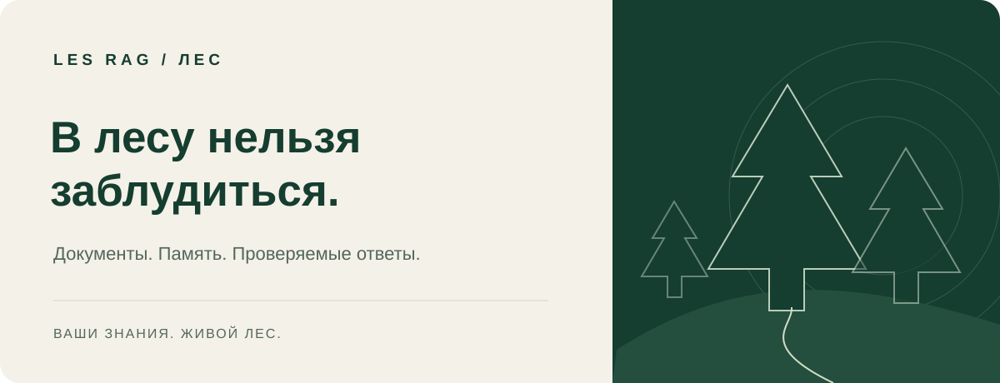
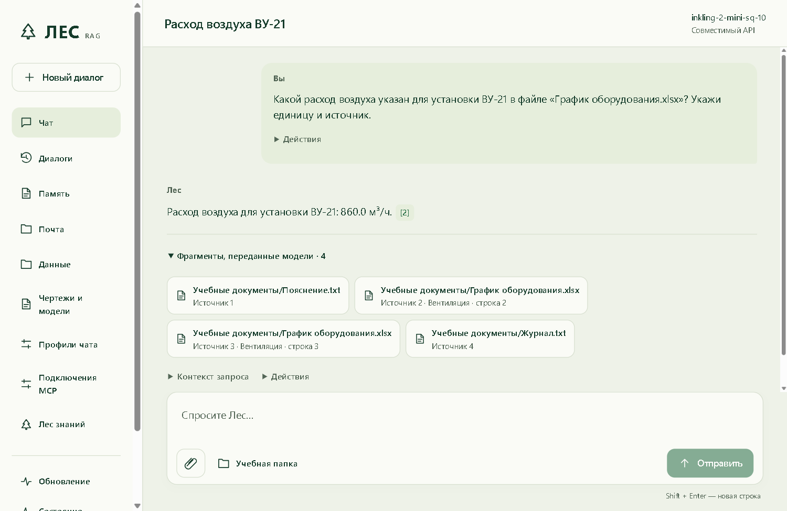
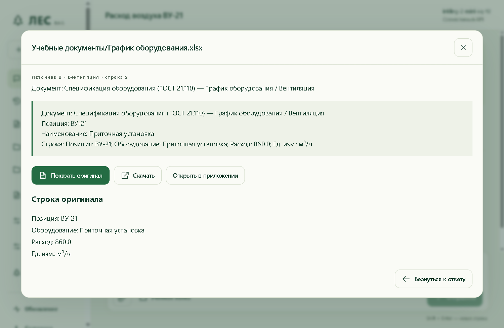
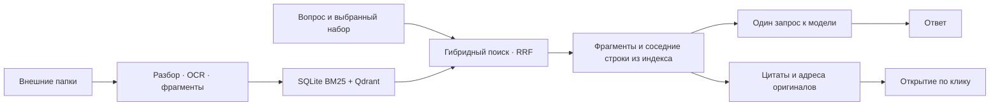

<strong>Ваши документы. Ответы с источниками.</strong>

<a href="README.en.md">English</a> · <a href="https://github.com/proovcme/LES/releases"><strong>Скачать для Windows</strong></a> · <a href="USER_GUIDE.md">Руководство</a>

LES RAG — настольное приложение для поиска и разговора по своим документам. Подключите модель, выберите папку в Проводнике и задайте вопрос. Из ответа можно перейти к документу и нужной странице.

## Чат и источники

На учебной папке ЛЕС нашёл расход из таблицы. Под ответом видны фрагменты,
которые получила модель, и ссылка на лист «Вентиляция», строку 2.

В карточке источника можно открыть ту же строку исходной книги.

## Как работает поиск

Внешние папки остаются на месте. ЛЕС отслеживает изменения и обновляет индекс.
Обычный вопрос по набору использует готовые фрагменты. При необходимости ЛЕС
добирает соседние части страницы или строки таблицы, укладывает их в контекст
и передаёт модели. Рядом с ответом можно открыть фрагменты, которые она получила,
и перейти к исходной странице, листу или строке.

Для анализа явно выбранного документа предусмотрено отдельное чтение оригинала.
API, CLI и MCP используют общий поиск и позволяют получать источники без вызова
модели ответов.

[Архитектура приложения](docs/LIGHT_ARCHITECTURE.md) · [Поиск и RRF](docs/modules/rag-ranking.md) · [API и MCP источников](docs/modules/native-source-mcp.md) · [История выпусков](docs/RELEASE_LEDGER.md)

## Установка и работа

- **Windows x64.** [Сетевой и полный установщики](https://github.com/proovcme/LES/releases), [установка и управление из терминала](docs/public/les-light/README.md#установка). Для установки WebView2, если его ещё нет, нужен интернет. Установщик без подписи издателя.
- **Модели.** Подключите локальную Ollama или совместимый OpenAI API. Модели ответа и поиска назначаются отдельно. Docker не нужен.
- **Приложение.** Чат Svelte, API и фоновые службы Rust. В Windows Python загружается при первом запуске одобренного скрипта внешнего навыка. В окне доступны проекты, память, профили чата, MCP и обновления.
- **Интеграции.** [MCP, API и CLI](docs/public/les-light/README.md#для-интеграций) · [macOS preview](docs/MACOS_PREVIEW.md) · [Ограничения и бэклог](docs/BACKLOG.md) · [Лицензия](LICENSE).
