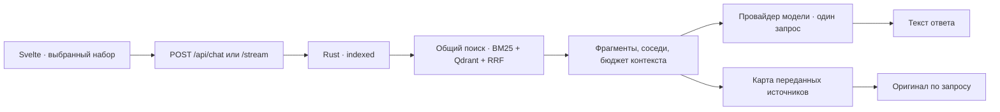

# Архитектура LES RAG

## Обычный вопрос по документам

Этот маршрут используется в обычном чате по набору без закреплённых файлов
и вложений. Источник несёт ID, редакцию и координаты из опубликованного индекса.
История даёт контекст в пределах выбранного диалога и профиля.
Назначение модели и ограничение окна определяет реестр моделей. Явные режимы
чтения документов и MCP используют тот же поиск и сохраняют свои контракты.
[Рабочий маршрут и проверки](modules/native-chat-context.md).

[Карта модулей](MODULE_INDEX.md) · [Точки входа и поставка](CODE_RUNTIME_MAP.md) · [Приёмка версий](RELEASE_LEDGER.md)

## Граница продукта

Light владеет чатом, проектами, документами, памятью, навыками, модельными
подключениями и RAG. Сметчик, Gemini-специфичные ветви и предметные алгоритмы
полного ЛЕС не должны находиться на пользовательском пути Light. Внешние
сметные источники подключаются через MCP и требуют явного выбора инструментов.
Build 738 удалил специализированные сметные файлы из исходной копии Light и
исключил сметные действия из общего чата, API и поставки. Общие исторические
ветви ещё нуждаются в аудите; установленный build 738 прошёл проверку запуска,
но не полную визуальную приёмку. Состояние — в
[карте границы](SEPARATION.md) и
[отчёте установки](RELEASE_LEDGER.md).

## Запуск Windows

Tauri запускает `les-runtime`. Он владеет процессами `les-api` и Qdrant.
`les-api` отдаёт Svelte и выполняет HTTP-запросы. Прежние закладки
`/classic` направляются в соответствующие разделы Svelte. Для
отдельного запуска FastAPI и проксирования в него больше нет точки входа.
Рабочие маршруты проверяются на реальном Rust HTTP-сервере.
[Снимок маршрутов](generated/native-api-routes.json).

## Пять границ реализации

1. **Ядро документов.** Одна модель набора, файла, извлечённого текста,
   фрагмента и оригинала. Все списки и счётчики используют одну видимость.
   Статус индекса подтверждается содержимым и доступностью поиска.
2. **Поиск.** Иерархия, dense + точный BM25 в SQLite postings, локальный RRF, rerank и контекст
   выполняются одним сервисом. API чата, дерево и MCP получают одинаковое
   происхождение. Никакого второго упрощённого поиска только для MCP.
3. **Модели и инструменты.** Реестр подключений, проверенные возможности,
   явные роли чата/эмбеддингов. MCP-клиент хранит выбранный набор read-only
   инструментов; сервер Light экспортирует лишь безопасные операции чтения.
   Отказ модели/сервера виден человеку и не подменяется ложным ответом.
4. **Интерфейс.** Общая оболочка с лесным логотипом, навигацией, полем поиска,
   списком и областью содержимого. Правила типографики, цветов, состояний и
   поведения задаёт UI kit. Страницы содержат только свою модель данных и
   действия. Полные цепочки «Данные → файл → оригинал → назад» и
   «Чат → источник → оригинал → назад» проходят через эту оболочку.
5. **Установка и состояние.** Один владелец нативного Qdrant, отдельная папка
   Light, динамические порты, проверка экземпляра и откат. Полный пакет,
   обновление, удаление и запуск на чистой системе проверяются отдельно.

Build 770 выделяет подготовку термов, проверку файлов и правила состояний заданий
в [Rust-библиотеку](modules/native-core.md). Python сохраняет нормализацию Unicode,
OCR/модельные интеграции, SQLite-транзакции и журнал публикации индекса.
Установка поставляет готовую библиотеку с контрольной суммой; откат совместим
с тем же индексом и состоянием. Полной переписи приложения не выполнялось.

Кандидат 776 дополнительно переносит владельца служб, HTTP-границу и SQLite
диалогов/черновиков в Rust. [Шесть нативных API-пар](modules/native-api.md)
и [обязательное хранилище](modules/native-workspace.md) ещё не заменяют
остальные API, harness, индекс, форматы и NiceGUI. Полный план и исключение для
автономных Python-навыков: [границы переноса](modules/python-exit.md).
Кандидат 777 добавляет [SQLite проектов/заметок/контекста](modules/native-catalog.md)
и увеличивает прямое владение API до 20/265 пар. Модельные и RAG-решения этим
переносом не меняются; остальное владение остаётся явно отмеченным в плане.
Кандидат 778 добавляет [файлы и память агента](modules/agent-workspace.md)
с Rust-историей и откатом, всего 22/267 пар. Существующий harness пока Python;
[готовый кодовый движок](modules/code-agent.md) только выбран для следующего этапа.

## Порядок замены

Начать с трассировки живых Light-маршрутов и зависимостей сборки. После этого
перевести общую оболочку, данные и чат целыми сценариями. Затем перенести
подключения, профили, память, навыки и почту в ту же систему. Удаление
унаследованных ветвей идёт только после регрессионной проверки их замен и
инвентаря импортов. Новые UX-эксперименты не отменяют доказуемость источника.

Тесты кода и API подтверждают поведение функций. Проверка установленного
приложения подтверждает упаковку и запуск. Визуальное принятие владельцем
подтверждает компоновку и удобство. Эти три вида результата фиксируются
отдельно в release ledger и отчётах приёмки.
