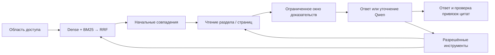

# Архитектурная сверка LES — кандидат 864

Дата: 2026-11-12. Проверен действующий Rust-путь публичного чата. Это аудит
исходников и кандидата, не сертификат поставщиков и не обновление установки.

## Первичные рекомендации и применение

| Источник | Принцип | Решение для LES |
|---|---|---|
| [Anthropic: Building effective agents](https://www.anthropic.com/research/building-effective-agents) | Начинать с простого решения; различать workflow и агентный цикл; ограничивать выполнение | Документный ответ может получать готовый контекст; инструменты остаются для уточнения и действий. Новый агентный фреймворк не требуется |
| [Anthropic: Effective context engineering](https://www.anthropic.com/research/effective-context-engineering-for-ai-agents) | Достаточный компактный контекст, ясные инструменты без лишнего перекрытия, подготовленное и динамическое чтение | Сохраняем Push/Hybrid, постепенное раскрытие инструментов, целые блоки и явное неполное покрытие |
| [OpenAI: Optimizing LLM Accuracy](https://developers.openai.com/api/docs/guides/optimizing-llm-accuracy) | Ошибка поиска и ошибка использования правильного контекста — разные причины | Раздельно оцениваем выбор документа, доставку страниц, цитирование и смысл ответа |
| [OpenAI: Evaluation best practices](https://developers.openai.com/api/docs/guides/evaluation-best-practices) | Проверки на реальных задачах, журналы, сложные и отрицательные случаи; калибровка судьи | Локальный контур и независимые эталоны. Чужой рейтинг судьи не заменяет проверку; облачный сервис Evals не нужен |
| [Microsoft: RAG overview](https://learn.microsoft.com/en-us/azure/search/retrieval-augmented-generation-overview) | Гибридный поиск, границы доступа, релевантный ограниченный контекст; разные издержки классического и агентного RAG | Qdrant + BM25 + RRF остаются. Навигация не подменяет глобальное ранжирование; область доступа проверяется до чтения |
| [Microsoft: End-to-end evaluation](https://learn.microsoft.com/en-us/azure/architecture/ai-ml/guide/rag/rag-llm-evaluation-phase) | Groundedness, полнота, релевантность и правильность — отдельные измерения | Совпадение чисел и ссылка не доказывают правильный вид документа или полный ответ |
| [Qdrant: Hybrid queries / Grouping](https://qdrant.tech/documentation/search/hybrid-queries/) | RRF и группирование уменьшают повторение одного документа | Применяем существующую квоту совпадений к автоматической подборке; это адаптация LES, не обязательный лимит Qdrant |

Это рекомендации, не доказательство оптимальности наших лимитов или модели.
Старый материал Anthropic отмечает изменение инструментального окружения;
используем принципы, не переносим устаревший стек. Новые модели, зависимости
и обязательный судья в этом изменении не добавляются.

Формальная связь цитат проверяется после выбора моделью; семантическая
правильность выбора из этого не следует. Квота и окно — разные ограничения.
При числовом договоре значения копируются из выбранных строк Rust; этот
договор не является проверкой правильности выбранного вида документа.

## Подтверждённые причины и исправления

### Неиспользуемая поисковая ветвь

Начальная подготовка вызывала поиск с `hierarchy=true`. Хранилище дополнительно
искало навигационные узлы и иногда потомков. Координатор использовал глобальные
совпадения и прочитанные разделы, но не передавал навигационные подсказки модели.

Теперь общий поиск получает внутреннее назначение: начальная подготовка
не запрашивает неиспользуемые подсказки, явный инструмент сохраняет их.
Dense/BM25/RRF, раскрытие родителей, проверки поколения и SHA-256 сохранены.
Удаление операций само по себе не доказывает ускорение всего ответа.

### Время восполнялось при каждом вызове

AgentLoop проверял срок между шагами, однако провайдер заново получал 600 секунд,
а допуск инструмента сообщал неизменные 600 секунд. Вложенные extensions также
не получали общий срок. Текущий долгий вызов мог пережить бюджет запроса.

Теперь один абсолютный срок задаётся в начале запроса. Подготовка, ожидание
модели, начальный поиск, запрос и поток провайдера используют остаток; сам цикл
получает остаток после подготовки. Допуск, таймауты инструментов и вложенные
extensions наследуют тот же срок. Завершение квитанции выполняется после таймаута;
внешняя обёртка не отменяет запись квитанции вложенного вызова. Это не гарантия
остановки уже начатого блокирующего действия: его последствия проверяются
по квитанциям. Ошибка не обещает сохранённый текст, которого могло не быть.

### Сохраняемая политика не работала в подготовке

`document_diversity_k` нормализовался и сохранялся, но Rust-поиск его не применял.
Начальная подготовка жёстко брала четыре совпадения вопреки `model_evidence_k`.

Автоматическая подборка теперь применяет лимит профиля с прежней верхней границей
16 начальных совпадений и квоту
совпадений одного документа. Идентичность включает набор, полный путь и редакцию.
Квота ограничивает поисковые начальные точки, не страницы при дочитывании.
Явный поиск с offset сохраняет весь ранжированный пул, включая поздние совпадения
того же файла. Trace показывает применённую политику. Это не гарантия релевантности.

### Оценки смешивали стадии

`evaluate_light_chat.py` использовал настоящий API, но карта видимых источников
не показывала, что модель сослалась на нужный документ. Другие исследовательские
программы используют прежний Python-путь и не являются приёмкой Rust-чата.

Расширен существующий испытатель: явные область и режим извлечения, отдельные
покрытия подборки, подтверждённо доставленного контекста и процитированных
документов. Сохраняются страницы, идентификаторы, хеши, раунды и расширение окна.
Неподтверждённая доставка не засчитывается; неизвестное — null. Смысловая
правильность остаётся отдельной оценкой. Регрессия проверяет правильное число
из неправильного источника при наличии правильного документа в контексте.

## Сохранённые границы и открытые вопросы

Evidence остаётся единственным владельцем допуска и доставки доказательств.
Packer, глобальный RRF, журнал публикации и проверки редакций сохранены.
Индексный читатель и физический PDF-читатель имеют разные гарантии; удалять
один как «дублирование» нельзя. Публичный чат использует общий AgentLoop core;
исправлена передача бюджета, второй цикл не добавлен.

Выбор технического документа вместо нужного согласования остаётся проблемой.
Повторная серия также выявила ответ из чужих гарантийных условий вместо
ограничения сведений по нужной спецификации. Полнота ответа, лишние строки и
надёжный отказ при отсутствии сведений не следуют из точного копирования.
Agent/Pull, точность оценки токенов для разных моделей и большая контрольная
выборка требуют самостоятельной приёмки. Реранкер и судья — только после
сравнения пользы. Не объявляем всё лишнее найденным и удалённым.
В текущем публичном Rust-чате запрос с включённым реранкером явно отклоняется
`NATIVE_RERANKER_CAPABILITY_PENDING`; это ещё не принятая опция рабочего поиска.
Аналогично не считаем действующими неподключённые validation и semantic cache.

## Приёмка кандидата

57 Rust API unit-тестов пройдены, включая истечение общего срока, запрет начала
действия после него и разделение физических документов при отборе. Предварительная
целевая серия — 77 passed. `make test`: 2163 passed, 2 skipped, 18 subtests
passed за 957,95 с. После уточнения полей измерителя повторены его 14 тестов:
14 passed. Окончательный `make verify` прошёл, собрано 2165 тестов. `cargo fmt
--check` и `git diff --check` прошли. Полный прогон содержит предупреждения
устаревающих тестовых зависимостей и loopback HTTP; они не являются приёмкой
качества реальных ответов.
Дополнительная проверка документов, runtime map, версий и профилей:
48 passed. Её первый запуск без переменной пути к MCP worker дал пять ошибок
окружения; с тем же полным окружением, что использовано в gate, серия прошла.
Код приложения ради исправления этого запуска не менялся.

Пять вопросов к Qwen3.5:9b в Hybrid/Search выполнены на прежней копии двух
пользовательских наборов без ручного выбора файла и передачи эталонов модели.
Вопросы о позициях разных страниц PDF, массе/количестве и листе изменения
содержат нужные значения с ожидаемыми источниками. В последнем ответе также
есть лишняя строка; наличие нужного значения не означает идеальной точности.
Вопрос о согласовании и отрицательный вопрос о гарантийном сроке не приняты:
выбраны неподходящие документы. Это не «пять успешных ответов».

Независимо проверены 13 выбранных строк/фрагментов: привязка к реально
доставленному окну, документу, SHA-256 и сохранённой цитате совпадает.
Эта сверка не превращает два содержательно неверных ответа в правильные.
Задержки пяти запросов: 12,31–24,05 с; единичная серия не доказывает ускорения.

Отдельный повтор исходного поискового запроса без ожидаемых имён/идентификаторов
в фильтрах показал: нужное заключение находится на 62-м месте глобального
пула 64, нужная спецификация впервые на 13-м. Они отсутствуют в начальной
подборке шести совпадений. Это подтверждает потерю нужного источника до ответа;
наличие текста в индексе не равно его доставке модели. Следующее изменение
должно сравнивать способы отбора документов и отказа на тех же положительных
и отрицательных случаях, а не расширять лимит или добавлять судью вслепую.

Приватные вопросы, имена, пути, ответы и журналы остаются вне публичного репозитория.
Рабочие индекс, модели и установленное приложение не переключались.
Испытательный API остановлен. Автоматическая проверка отклонила рекурсивную
очистку временных тестовых папок без подробного объяснения; их удаление
не выполнено. Свободное место после проверки — около 25,7 ГиБ.
