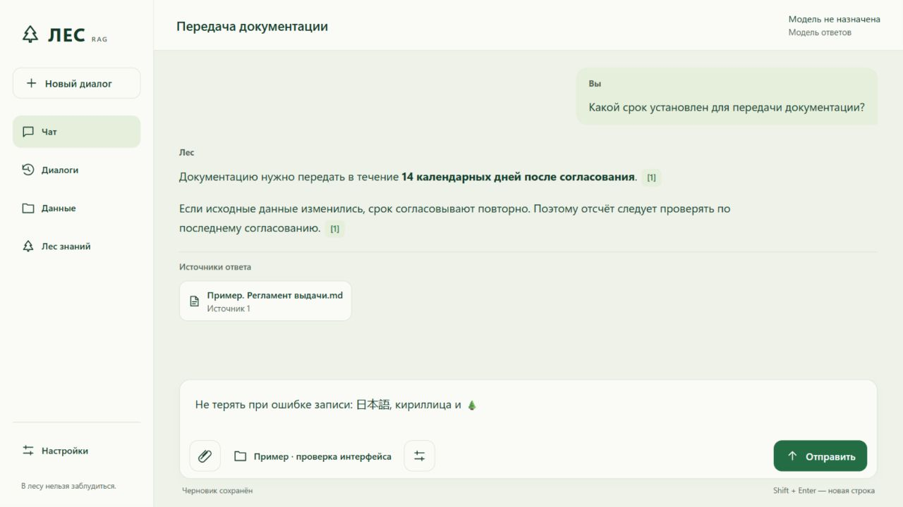
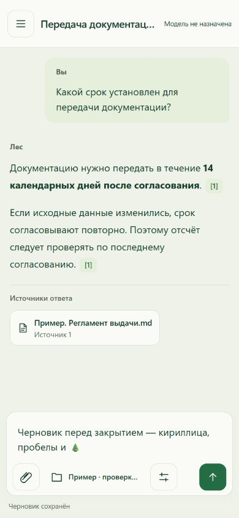

# Build 772 — сохранность, подтверждение действий и приёмка чата

Отдельный кандидат поверх исходников 771. Рабочая установка 770, её база,
назначения моделей и пользовательский корпус не изменялись. Публичного выпуска и нового
установщика нет. Проверка модели и качество RAG не подменяются этой приёмкой.

## Индекс

Воспроизведён дефект старта: несовместимая коллекция могла удаляться по нулевому
или отсутствующему CollectionInfo.points_count при наличии реальных точек.
Семь новых сценариев не проходили на прежней реализации. Теперь создание,
проверка и замена выполняются под общей lease записи/восстановления; пустота
подтверждается exact count. Ошибка чтения не превращается в «коллекции нет».
Совместимая коллекция также не принимается как пустая по общему счётчику.

При чистом журнале точное число сверяется с нижней границей каталога INDEXED.
Если точек меньше либо сама коллекция отсутствует при сохранённых фрагментах,
поиск блокируется понятной ошибкой без пересоздания или изменения каталога.
Это ограниченная проверка: лишние/осиротевшие точки могут маскировать недостачу
отдельного файла. Полный аудит по файлам и причина исторического исчезновения
точек не объявлены закрытыми.

На настоящем отдельном native Qdrant: в legacy-коллекцию записана точка,
ответ get_collection намеренно подменён на нулевой общий счётчик. Защита
сохранила точку, её ID/payload пережили перезапуск. После явного удаления этой
одноразовой точки пустая миграция прошла. INDEXED в каталоге при нуле точек
отвергнут. Модели не использовались.

## Действия модели

DocumentReviewTool и работа по строкам формируют execution receipt из свежего
журнала. Модельный текст не источник статуса. pending/needs_recheck/blocked и
needs_review не становятся подтверждённым завершением. Запись всех решений
подтверждает только сохранение; accepted остаётся false.

Receipt идёт в trace, ответ API и восстановленную историю. Оба интерфейса
показывают его отдельно от свободного ответа; Svelte сохраняет вопрос для
продолжения незавершённого действия. Обычное чтение ячейки не требует проверки
всей таблицы. Автоматического выдумывания решений или принудительного record нет.
Реальная надёжность многошаговой работы Qwen остаётся отдельным испытанием.

Устранён второй дефект: ensure_chat_history_schema при каждом чтении мог менять
сохранённый success=0 на 1. Backfill выполняется только при добавлении столбца;
новые незавершённые действия сохраняют success=0 независимо от заявления модели.

## Закрытие

Редактор регистрирует готовность у Rust до разрешения ввода. Обычное закрытие
крестиком/через трей ждёт flush последнего черновика и остановки текущего потока.
Повторное нажатие относится к тому же запросу; старое подтверждение отвергается.
Ошибка записи сохраняет окно и текст. При записи закрытие разрешается явным ack.

Границы IPC заданы AppManifest/capabilities и проверкой текущего окна, точного
порта API и пути /app/ в Rust. Origin заголовка IPC не содержит pathname:
первый живой запуск выявил отказ слишком узкого URL pattern; исправлено на
loopback origin с сохранением проверки пути в Rust. Readiness подтверждён
реальным editor_ready, не только загрузкой HTML.

Нормальное нативное закрытие с Unicode-черновиком прошло; сохранённый текст
восстановился после запуска на новом порту. Отдельная SQLite BEGIN IMMEDIATE
блокировка одноразового каталога вызвала отказ записи: native close получил
blocked, окно осталось открытым, текст с кириллицей, 日本語 и emoji сохранился
в поле. После снятия блокировки повторное закрытие получило saved, процесс
завершился; новый запуск восстановил точный текст. Принудительный kill/сбой питания
в течение autosave 400 мс этим протоколом не защищён. Полное восстановление
renderer, logoff и экранный диктор остаются открытыми.

## Интерфейс

Владелец разрешил Computer Use для браузера и отдельного тестового окна.
При 1280×720: шапка 88→72 px, нижняя область 271→181 px, переписка 361→467 px
(примерно +29%). Источники видны по именам; дополнительные параметры убраны
из постоянной строки. Ссылки не отрываются отдельной строкой от текста.
Снижено количество подписей, приведены к общей сетке отступы и кнопки.

На 390×844 проверены отсутствие горизонтальной прокрутки, доступность всех
кнопок ввода, параметры поиска, Escape и возврат фокуса. Источник открывает
реальный файл и возвращает к черновику. Снимки используют авторскую демонстрацию,
не ответ модели и не пользовательские документы.

Проверка оригинала выявила унаследованный заголовок «Л.И.С.Т.» и ссылку raw
по path вместо каталожного ID. Просмотрщик обновлён, в маршрут by-id передаётся
канонический documentId; путь и старые callers сохранены для совместимости.
Живой iframe подтвердил заголовок ЛЕС и raw-ссылку с каноническим ID.

Остальные экраны пока NiceGUI. Полной визуальной унификации, ускорения старта,
экономии памяти NiceGUI и полного WCAG этот этап не доказывает.

## Итоговый gate

- make verify: 1400 тестов собраны; синтаксис, карта кода и версии согласованы.
- make test с подключённой штатной Rust-библиотекой: 1396 passed, 4 skipped,
  18 subtests, 124.18 с. Это время тестов, не измерение скорости RAG.
- make test-mail: 66 passed.
- Frontend: 25 passed; Svelte/TypeScript: 0 errors, 0 warnings.
- cargo test desktop: 5 passed; release-кандидат собран и запускался отдельно.
- Native Qdrant: сохранение ID/payload после рестарта, пустая миграция и
  блокировка несовпадения с каталогом подтверждены на одноразовом состоянии.
- public-check и git diff --check прошли; релиз не публиковался.

Временные браузер и desktop-кандидат закрыты после проверки. Рабочий 770
не перезапускался и не обновлялся. Полный установщик 772 и installed user journey
не выполнены; текущие результаты относятся к исходникам и отдельному кандидату.
