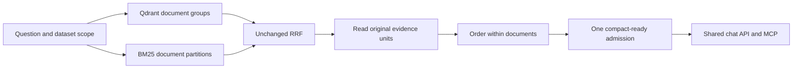

# Evidence delivery: isolated stages (885–891)

Working LES remains 880. All stages run only against the existing copied corpus,
without Qwen, manual source selection, model changes or reindexing.

## 1. Compact packet

`LES_EXPERIMENT_EVIDENCE_PACKET=compact-v1` is an explicit copy-only control for
`search_sources(view=context)`. Retrieval, original reading, lexical/MMR selection,
order and quotas are unchanged. It is incompatible with the RRF-order experiment.

The versioned `les.evidence-packet.v1` representation retains each full source once
in `sources`; a passage has a one-based `source.ref`. Text, canonical tables,
formulas, edition hashes, aliases, warnings and pinned links are preserved.
Encoding/decoding must round-trip exactly. Invalid/conflicting references are
not evidence. Main-chat admission and its model projection resolve the same table.
Ordinary clients/launches keep the existing representation.

Final admission measures the compact representation using the existing limits,
not the expanded compatibility view. Existing prefix admission is retained, so
this stage does not combine a new ranking policy with a wire-format change.
The MCP protocol's text/structured forms are not changed; byte duplication there
does not by itself prove duplicate model-token usage by a client.

Required comparison: baseline versus packet on the same questions/index, equal
pre-admission fingerprints; source/text/page/row/overview delivery, real MCP
size/latency, link and revision checks. No result is claimed before completion.

## 2. Saved canonical reading units

`LES_EXPERIMENT_SAVED_READING=canonical-v1` prepares a separate saved-unit reader.
It scans the published Word units, checks all text/structure digests and owner
coverage, and verifies the original SHA before/after plus the index revision.
Missing legacy representation explicitly falls back to the original reader;
corrupt units and changed generations are errors. Ordinary launches are unchanged.

The reading-view digest binds the ordered saved units and original identity.
It is not the old parser-view digest. Original ordinals are retained separately
from saved-stream offsets, so citation jumps and continuation use the right view.
The same `read_source` exposes this view through chat and MCP. Its scope is
published reading units, not a claim to read every visual or the complete original.
Explicit query/clause reads keep the original reader. No parser/index rebuild.

## 3. Overview coverage

After stage 2, test document-level grouping with balanced lexical/dense discovery,
then evidence reading inside each document. Grouping only an already truncated
pool cannot recover displaced documents. A bounded result never claims complete
corpus coverage. Precise page/table questions remain a regression gate.

## Measurement boundaries

Needed-source delivery matches exact original SHA values after retrieval, because
catalog IDs differ between the source benchmark and its copy. It is byte-equivalent
source coverage, not a claim that all path/edition instances or current normative
authorities were identified. Page/row/cursor checks are reported separately.
Raw questions, documents, manifests and traces stay private; public documentation
contains sanitized aggregates. Generated-answer correctness is not measured here.

## Completed stage 1 comparison

API source `dabc2da`, 131 API tests and 114 native passes / one optional skip.
All 200 real stdio MCP calls completed, two formats on the same 100 questions,
counterbalanced by query hash in four serial half-periods. BGE, disabled reranker,
questions, index generation, originals, selection and quotas were unchanged.
The evaluator decodes references after retrieval; raw MCP frames are retained.

| Measure | Existing packet | Compact packet |
|---|---:|---:|
| Needed-source delivery, 90 positive cases | 64.63% | 69.07% |
| Reference-text coverage, 69 cases | 53.29% | 56.52% |
| Expected-page hit, 12 cases | 91.67% | 91.67% |
| Expected-page coverage, 12 cases | 87.50% | 87.50% |
| Excel-row hit, 2 cases | 100% | 100% |
| Overview-source delivery, 4 cases | 29.17% | 29.17% |
| Observed MCP p50, 90 positive cases | 8.43 s | 9.20 s |
| Mean body characters, all 100 cases | 7,432.65 | 10,009.37 |
| Mean delivered passages, all 100 cases | 4.54 | 6.72 |

Four source cases and three reference-text cases improve; no scored source/text/
page/row cases regress. Paired 95% bootstrap intervals (20,000 fixed-seed draws)
for source/text deltas are [1.11, 8.89] / [0.00, 7.58] percentage points. This
repeatedly used development set is not independent answer-quality validation.
The format does not solve overview coverage and has no observed speed gain.

All 100 pairs have identical selected-unit fingerprints before wire admission.
Retrieval/read-plan fingerprints also match. Materialized reading pools differ
in two cases (one positive, one predeclared diagnostic) because of opposite
30-second Word-worker timeouts, but these differences did not change the selected
units. Both formats expose one `WORKER_TIMEOUT`; no new case is excluded.

All 200 raw text/structured MCP payload pairs agree and every source handle binds
the aligned full source. Both decoded cohorts respect the body quota and exact
same-source deduplication checks. Independent original/PDF checks by half-period
were 113/103, 149/170, 141/148, 124/130, with zero byte/page/digest/cursor errors;
these are per-period counts, not distinct originals across the whole experiment.
No selected derived-page units were newly covered. Copied catalog rows and every
original SHA remain unchanged. Resource floors were maintained and copy APIs
stopped before the next build. Working LES remains 880.

Stage 2 source `f284286` passed 132 API tests and built. Its first native run
passed 114, skipped one optional case and failed the new saved-reader case:
the fixture published a valid legacy unit, which the new loader incorrectly
treated as corrupt because both layouts use the v1 reading container. Inspection
confirmed its text and structure digests were valid and no canonical tree existed.
The correction distinguishes the nested canonical schema after digest validation;
the legacy fallback and a fixture with the real native Docling parser are now
separate cases. The first targeted repeat passed legacy fallback but exposed
`DOCUMENT_PARSER_CACHE_INVALID` during native Docling indexing: the batch worker
did not receive `owned_state`, relying on ambient `LES_STATE_ROOT`. The API now
freezes its owned state root into the batch and forwards it to the format worker;
the regression deliberately removes that environment variable. No source folder
is used as scratch space. The correction passed 172 core / 132 Edge API tests,
116 native checks with one optional skip, 56 frontend tests, frontend checking,
`make verify` (2,233 collected, not executed) and the publication audit.
Its original-reader arm holds compact transport fixed. No installation/release.

## Overview candidate 888 (not accepted)

`LES_EXPERIMENT_OVERVIEW=grouped-v1` is only active for explicit
`search_sources(view=overview)` with compact packets. `original-v1` preserves
the precision pipeline for a comparison with the same request intent.

Qdrant native grouping requests two hits per file before channel top-k. Requests
are dataset-local so equal names in separate datasets remain independent;
intermediate results are merged by original scores and retained at bounded top-k.
SQLite uses ROW_NUMBER partitioned by dataset/file before LIMIT, with unchanged
global BM25 statistics. There is one dense and one lexical vote, unchanged RRF,
BGE and disabled reranker. No corpus mutation or payload migration.

Documents follow their best fused prior. Existing relevance chooses reading
units only within each document; documents are interleaved before the single
compact-ready admission. No per-unit reserved kilobyte or earlier text quota
is spent by this ordering. Non-fitting units are skipped whole, not truncated.
The receipt distinguishes readable/delivered/omitted primary documents and
never claims exhaustive corpus coverage. Precise context requests are unchanged.

The dataset-local dense fanout is bounded by the existing 512-dataset scope
contract; retained result memory is top-k, but latency can grow with scope.
Large multi-dataset latency and semantic overview completeness remain acceptance
questions, not solved by grouping alone. No automatic query-type heuristic.
The explicit tool is shared by chat, API and MCP; automatic main-chat prefetch
continues to request precision context. No new UI controls.

## Completed stage 2 comparison

API source `504e37a`, the same copied index and unchanged 100-question cohort.
All 200 real MCP calls completed in four counterbalanced half-periods; both
arms used compact transport. Every selected-unit fingerprint, retrieval pool
and read plan matched across all 100 pairs. The readable pool differed in five
cases, including different saved view identities and two Word worker timeouts
in the saved arm. The selected evidence was unchanged; no case was excluded.

| Measure | Original reader + compact | Saved reader + compact |
|---|---:|---:|
| Needed-source delivery, 90 positive cases | 69.07% | 69.07% |
| Reference-text coverage, 69 cases | 56.52% | 56.52% |
| Expected-page coverage, 12 cases | 87.50% | 87.50% |
| Excel-row hit, 2 cases | 100% | 100% |
| Overview-source delivery, 4 cases | 29.17% | 29.17% |
| Observed MCP p50, 90 positive cases | 7.80 s | 8.63 s |
| Mean body characters, all 100 cases | 10,009.37 | 10,009.37 |
| Recorded Word worker timeouts | 0 | 2 |

The saved loader completed five reads of four distinct real documents and used
legacy fallback 702 times. These are read attempts, not counts of unique legacy
files. No saved-unit source reached final admission in this cohort, so this run
cannot establish the quality or speed of a predominantly saved-unit corpus.
The fixture with real native Docling separately verifies saved table text,
canonical cells, cursor jumps and rejection after original replacement.

Both raw MCP representations agree and all one-based source references bind
the aligned full source. Independent original/PDF checks by half-period were
141/148, 149/170, 141/148 and 149/170, with zero errors. These are per-period
counts. All catalog rows and original SHA values remained unchanged. The
minimum observed available RAM was 6.23 GiB; owned-service peak working sets
were 2.51–2.67 GiB. Copy APIs stopped before the next serial build.

There is no observed delivery gain and no speed gain; the saved experiment
remains off. The published corpus representation must be migrated deliberately
before claiming broad fast-path coverage. Adding the same representation
alongside the old index without verifying completeness would hide that gap.
Stage 3 therefore holds `original-v1` reading fixed in both arms; only explicit
overview discovery/admission changes. Working LES remains 880.

## Cursor ingress correction 889

The first two native runs completed discovery, grouping and pinned original
checks but failed the new cursor-rejection assertion. The generic API boundary
asked for index_revision before rejecting a context snapshot offset, while the
chat search path rejected it separately. This gave clients an impossible next
action. A shared snapshot classifier/validator now rejects context and overview
offsets before continuation handling, with HTTP 422 and the explicit document
reading tools. Real document streams still require their revision/cursor pins.
The native regression covers both views with and without a revision. This is an
ingress-contract correction, not a relaxation of source or citation checks.

## Rejected first overview comparison

Source `48552aa`: 48 real MCP search calls, 24 fixed questions in two arms,
including four previous overview questions, eight prospective descriptive
questions and twelve precision regressions. The output allowance, BGE, disabled
reranker, original reader and copied index were fixed. Both arms completed with
zero tool-call errors; original/PDF/Word cursor checks were performed separately.
The prospective questions have no complete answer oracle and do not get an
invented quality percentage.

Needed-source delivery on the four overview questions fell from 29.17% to 8.33%;
observed p50 rose from 6.84 to 9.64 seconds. The first grouping strategy is rejected.
Inspection also found directory tables crowding the electrical briefing context;
source presence alone must not be reported as factual briefing completeness.

The implementation grouped by document but fused by point ID. Dense and BM25
hits in different units of one file therefore failed to combine, while a common
directory unit hit by both channels received two votes. Dense retention also
still spent its top-k on individual anchors after native grouping.

## Document-fusion correction 890 (comparison complete)

The copy-only flag is now `LES_EXPERIMENT_OVERVIEW=documents-v2`; the rejected
`grouped-v1` flag is no longer accepted. Both channels rank document identities
(dataset, full file key, source SHA) before the existing RRF. Different anchors
in the same document provide one vote per channel. Native dense retention and
SQLite prefetch are bounded by document capacity, not duplicate anchor count.

Only after document fusion are up to two reading anchors chosen, retaining the
two channel heads within capacity. Entire document-anchor bundles use the existing
64-anchor pool; reservations preserve channel-head membership without promoting
its relevance rank. All actual source IDs, payloads and revision guards remain
intact. Conflicting payloads for the same point still fail before admission.
Per-point debug provenance explicitly declares document fusion and anchor ranks.
The normal precision path is unchanged. The repeat uses the same frozen cohort,
without new filename filters, query rewrites, model changes or reindexing.

Source `e27e96a`: all 48 real MCP search calls completed on the same 24 frozen
questions in four counterbalanced half-periods. Both arms retained compact
transport, original reading, BGE, disabled reranking and the same limits.
There were no tool-call errors. This is a development comparison, not held-out
acceptance or an answer-model evaluation.

| Four reused overview questions | Original | Document fusion |
|---|---:|---:|
| Mean required-source fraction in retrieval/readable pool | 41.67% | 58.33% |
| Mean required-source fraction finally delivered | 29.17% | 29.17% |
| Observed MCP latency p50 | 7.89 s | 11.40 s |

All four per-question delivery fractions were unchanged, not just the average.
Ten positive precision regressions retained the same source/quote/page/row
outcomes; two absence probes had no tool-call errors. The two page probes and
two Excel probes retained their expected locations. Eight prospective overview
questions still have no complete gold answer; their observed p50 changed from
9.83 to 14.62 seconds and no recall percentage is assigned to them.

Offline stage accounting located one lost expected-source instance between
selection and wire in the original overview arm and three in the document-fusion
arm. Seven versus five expected-source instances were absent from all observed
pools; their rank outside the pool is unknown. These are source instances across
questions, not unique corpus files. There was no observed overview source loss
between the read plan and readable pool. Thus correcting document voting found
more annotated sources, but the final evidence package did not deliver the gain.

Manual inspection of the returned volume/electrical packets found repeated
composition tables and an exactly repeated 1,497-character passage. That passage
was delivered once as a full physical PDF page and once as an indexed excerpt.
The selector's content key omits heading context only for a self-contained reading
unit, so those representations receive different keys. A generic reproducer gives
two units for mixed completeness declarations and one for consistent complete
declarations. This explains this duplicate; it does not establish that every
same-text excerpt can safely lose its heading or be merged across editions.
Uniform, verified reading-unit identities are needed before collapsing sources.

Original/PDF-page/Word-unit checks by period were 47/31/32, 69/53/31, 52/26/40
and 50/32/30, with zero errors. Counts may repeat sources across periods. The
Word checks establish exact cursor/text/canonical agreement, not an independent
semantic parser oracle. All 638 catalog document rows and original SHA values
remained unchanged. Minimum observed available RAM was 7.01 GiB; the observed sum
of owned-service working sets peaked between 1.80 and 2.40 GiB by period.

The new overview configuration has no observed delivery or speed benefit and is
**not accepted for working LES**. The document-voting defect is corrected on the
copy; final context admission and mixed reading representations remain open.
The experimental mode stays off. The next registered comparison must isolate
admission/representation, rather than retune discovery against these four probes.

## Validation setup

The redundant private scratch-cleanup hook invalidated an initial full-suite
attempt by removing pytest's empty name reservations; path reuse returned stale
cached fixture results. A two-case reproducer failed with that hook and passed
with repository cleanup. The invalidated attempt is retained and not scored.
A subsequent full run passed 2,231 cases but failed two packaging cases because
the UI build receipt was missing (four optional skips). After the normal frontend
build, all 16 package/asset cases passed. `make test` now checks the current UI
receipt before starting pytest.

The clean full repeat on source `d0141e1` passed **2,234 cases and 18 subtests**,
with four skips and no failures; `make test-mail` then passed **66 cases**.
Skips are POSIX TCP semantics, the macOS supervisor, an unprovided separate
embedding-worker specification, and the opt-in real Windows SMB share. The
local/Edge folder-watch and publication-crash cases did run; a live SMB test
must not be inferred from them. The packaged autonomous skill interpreter and
its corruption rejection also ran. Full suite/mail time was 1,136.77 seconds;
minimum available RAM was 8.51 GiB and free disk stayed above 39.05 GiB.
All copy APIs were stopped after comparison. This is source/copy acceptance,
not an installed update or independent answer-quality result.

## Ready overview admission 891 (comparison complete)

Explicit copy flag `LES_EXPERIMENT_OVERVIEW_ADMISSION=ready-v1`, off by default.
The control uses `baseline-v1`. Discovery stays `documents-v2`, with the same
index, BGE, original readers, ordering and output allowances in both arms.

Ready evidence has typed bodies and independently pinned origins. Only exactly
equal text/canonical content and equal semantic heading/sheet/warning context
share a body. Physical and indexed representation labels no longer manufacture
different body keys. Different occurrences within one document remain separate;
formulas, numerical changes and unknown semantic metadata remain significant.
All source identities, URLs, physical cursors and extraction claims are preserved
per origin. Sharing text never declares a shared edition or physical object.

The existing sole overview admission measures the complete compact response,
including all retained origins, under unchanged limits. Coverage v3 counts
document origins rather than mistaking a shared body for a missing document.
Every delivered prepared origin is checked against its original bytes before
API/MCP return and again after chat generation. Ordinary precision selection,
explicit source-stream cursors and working LES remain unchanged. This isolates
ready packaging on the existing development cohort, not the whole V0–V4 matrix.

The chat retains the other origins in the admitted block even when its primary
source was already prefetched; it replaces that block rather than repeating its
body. The source panel exposes the same origins with independent revision/page
and cursor pins, including a return to the previous original. This is functional
MCP/chat/UI parity for shared bodies, not an unrelated shell redesign.

Redundant identity normalization reuses the checked existing source-schema rule:
a locator repeating the same source SHA/page and a parent heading repeating the
section heading do not create a new body identity. Full origin records remain
unchanged. Extra locator geometry, conflicting pins and different parent headings
still separate evidence. Prepared origins are mandatory under wire pressure:
admit the whole body with its pins or skip it, never silently compact its origins
back to primary-only provenance.

The first setup attempt was rejected before retrieval because the BGE capability
snapshot had expired. The existing connection was probed again through the native
API, without changing its assignment or bypassing expiry checks. A later smoke
still retained a real duplicate; that partial comparison was stopped and retained,
not scored. It exposed the missing early normalization of repeated identity fields.

The Word conversion cache currently includes the full API executable fingerprint.
An API rebuild therefore causes cold conversion misses even with unchanged parser
assets. Within a comparison both arms use one binary and counterbalanced periods;
latency across different builds/cache states is not a speed comparison. Separating
an explicit conversion-recipe revision from unrelated application changes remains
an architecture task, without weakening source/settings/parts validation.

### Controlled repeat 891

The frozen 24-case manifest SHA-256 is
`1f3bd3d0922fc0800ce5fa08128b8da4627c3ca4ef1a17edebb340f0893ae183`.
Private questions, per-case replies and originals remain local; public evidence
contains code, the protocol and aggregate results. Both arms used the same
release/O2 binary with LTO disabled; this is not a product-release speed benchmark.

Source `6417b49`, same frozen 24 questions, 48 real native stdio-MCP searches,
four counterbalanced half-periods. Discovery stayed `documents-v2`, original
reading, BGE, reranking off, 12,000 body characters and the same compact wire
allowance. No answer model or expected-file filter was used. All **96** paired
pre-admission order/content fingerprints matched (24 questions × four stages).

| Measure | Baseline admission | Ready-body admission |
|---|---:|---:|
| Required-source fraction, four reused overviews, retrieved/readable | 58.33% | 58.33% |
| Required-source fraction, same four overviews, delivered | 29.17% | 29.17% |
| Observed overview p50 | 12.65 s | 11.52 s |
| Prospective descriptive probes p50, eight without complete gold | 14.60 s | 11.06 s |
| Search tool errors | 0 / 24 | 0 / 24 |

All ten positive precision probes retained their same source outcomes; six
reference-text checks, two page checks and two spreadsheet-row checks were
unchanged. The two absence probes had no tool errors; this is not a claim about
model abstention. None of the four scored overview source fractions changed.
The two observed p50 differences are timings of this run, not an accepted speed
improvement or a statistically established advantage.

In the volume overview, the observed 1,497-character body with the same heading
went from twice to once. Ten other-original references remained in the delivered
ready packet, and original-byte and physical reader checks passed. This fixes
ownership/provenance for that duplicate; it did **not** rescue additional gold
sources. Literal equality with a different heading/occurrence remains separate.

Stage accounting still loses three question/source pairs at final admission;
five other pairs are absent from all observed pools (rank outside them unknown).
No overview loss occurs between the read plan and readable pool in this repeat.
The correction is therefore **not accepted as a solution to overview quality**;
the experimental overview paths remain off and working LES stays 880.

Per-period separate original/reader checks verified original files / PDF pages /
Word cursors as 52/26/40, 70/53/31, 69/53/31 and 49/26/35, with zero errors.
These counts may repeat originals between periods. All 638 copied document rows
and original SHA-256 values remained unchanged. Minimum available RAM was
6.20 GiB; peak owned service-tree working set was 2.29 GiB. No second index was
created. The eight descriptive probes remain unscored for quality; this is reused
development evidence, not independent acceptance or answer correctness.

### Remaining reading/admission boundary

The final admission pool is much larger than the indexed read plan: across the
four scored overviews, 107–123 planned indexed units became 2,504–6,841 ready
units. The Word automatic hydrator reads every unit of each matched original
before final selection; compatible unit hashes alone inherit the indexed anchor
rank. This is an observed fan-out and a code-confirmed boundary, not proof that
every later loss has the same cause. Do not present generic body deduplication as
a fix for it. The bounded-reader contrast must preserve actual anchor/section
lineage, table continuations and explicit read-more cursors; a small prefix or
question-specific document rule is not an acceptable substitute.

Pure Tauri formatting has been moved to separate PR #9. PR #8 is stacked on that
formatting branch, so its current diff contains no Tauri source formatting.

A separate offline histogram audit found at least one compatible ranked Word
entry for every observed Word source in each of the four overviews; no entire
Word source was unanchored. The histograms include equivalent-point aliases and
must not be reported as unique unit counts. Thus whole-document fan-out is
confirmed, while a blanket failure to carry anchor identities is **not** supported
by this run. Within-document lexical/prior ordering also remains in the control;
its isolated effect has not been established by this admission-only contrast.

### Validation of the final source/copy candidate

API edge: **140 passed**. The generated real-PDF shared-body/revision-change
case passed on the final binary. The full `make test` run passed **2,235 cases
and 18 subtests**, with four skips and no failures; `make test-mail` passed
**66 cases**. The existing platform/opt-in skips remain: POSIX TCP behavior,
macOS supervisor, unprovided separate embedding-worker specification, and real
Windows SMB. Local/Edge recovery/publication-crash and the autonomous packaged
skill interpreter with corruption rejection did run. This does not validate
every user-authored external skill or a live mailbox.

Frontend: **57 tests passed**, typecheck had no errors/warnings, the real static
UI build/receipt passed. The isolated SourcePanel browser example checked origin
switching, pinned Word reading and Escape/focus return with synthetic data;
native window/mobile/screen-reader acceptance remains open. `make verify` and
publication checks passed; the installed application was not changed.

Full suite plus mail took 1,156.80 seconds; minimum available RAM was 7.51 GiB
and free disk 35.37 GiB. Test copies were cleaned by the repository fixtures;
no redundant cleanup hook was added. Copy APIs and the owned UI preview were
stopped. Source/copy checks are not an installer release or independent RAG
answer-quality acceptance.

## Bounded Word reading 892 (copy comparison completed)

The temporary full/section control was compared over 216 actual MCP calls, then
removed from the current candidate: automatic Word reading is now bounded.
Working LES remains 880. The automatic Word hydrator resolves each indexed unit
by ordinal plus text SHA, with unique literal
alignment for legacy anchors. Unresolved/ambiguous anchors are explicit unread
failures, never a hidden whole-document fallback.

Section-v1 retains every resolved retrieval anchor, its closest heading section
and descendants, and adjacent original reading units under the existing per-read
character allowance. Long sections expand contiguously around anchors; an
oversized atomic row remains intact and a blocked direction does not jump across
it. All already carried headings/table headers, cells/formulas and original
ordinals/stream offsets remain unchanged. Explicit read_source pagination is
unchanged. Format conversion still builds the whole structural view and may
repeat after executable changes or bounded-cache eviction/entry-size rejection.
This change bounds automatic evidence materialization, not initial ZIP/XML parsing.

Each unit now keeps its actual matched/nearest retrieval-anchor ID instead of
borrowing the first hit's ID for every paragraph. This lineage fix and explicit
original stream offsets are common to both comparison arms. The read-plan
summary distinguishes original, retained and unresolved units. Partial windows
are bounded evidence, never a claim to have read the whole document.

Same copy/BGE/index, ready admission held fixed: all 216 paired checks of the
first two retrieval/read-plan fingerprints are equal; all 1,883 matched anchor
occurrences remain. Word units shrink 385,622 → 35,747 across 108 searches per
arm. Source/quote delivery changes 71.30%/60.54% → 72.41%/61.99%; the four reused
overviews remain at 29.17%. One short TOC-reference regression is retained and
explained in the [full protocol](../acceptance/bounded-word-reading-892.md).
Page/row outcomes and exact original-reader checks are preserved. This is not
independent answer-quality acceptance. No Qwen or expected-file filters were used.
Overall p50 is essentially unchanged, and two cold Word overviews became slower;
do not claim an end-to-end speed improvement from the smaller pool.

The first expanded 108-case attempt stopped on a literal context of 12,002
characters under a 12,000-character request. This was a real final-admission gap:
the selector estimates normalized search-unit text, while the compact context
admission checked only the wire envelope. The incomplete attempt is retained and
not scored. Both reader arms now use a common literal-text final context guard,
for compact and ordinary JSON snapshots. Whole non-fitting units are skipped;
explicit read_source streams retain their existing contiguous cursor behavior.
This common guard change must be declared when comparing with earlier builds.
