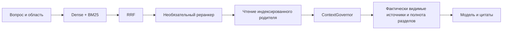

# Сравнение архитектур RAG · build 764

Владелец испытательных вариантов — `proxy/services/retrieval_trial_policy.py`.
Это именованные параметры вызова внутри офлайн-стенда, без новых кнопок и
переменных среды, меняющих основной чат. Production по умолчанию использует
`CURRENT`; схема, embeddings и роли рабочего приложения не мигрируют.



Это минимальный испытательный маршрут. Профиль `hierarchy` добавляет мягкий
иерархический поиск. `current` сохраняет действующие FTS safety merge, точные
продвижения, retry и готовые дополнительные индексы. Варианты `without_*`
отключают по одному этапу; отключённый этап не заменяется другим скрытым этапом.
Наличие в коде RAPTOR/ColBERT не означает их готовность или запуск в конкретном
испытании. Реранкер во всех записанных прогонах выключен; его выигрыш не заявлен.

## Запуск на замороженном корпусе

```text
python tools/evaluate_rag_pipeline.py --snapshot snapshot.json --queries queries.json --cases cases.json --output NEW_DIR --qdrant-exe PATH
```

Форматы snapshot/queries/cases совпадают с [контуром 752](retrieval-candidate.md).
Стенд запускает собственный нативный Qdrant в новом каталоге, создаёт точный BM25
и FTS на одной копии, вызывает настоящий `retrieve_chat_chunks`, ChatSectionReader
и ContextGovernor. Вектор запроса берётся только из frozen export. Новый или
переформулированный запрос останавливает испытание; обращения к модели нет.
Gold ID применяются после поиска только для подсчёта метрик.

`--profiles` выбирает именованные варианты; `--rrf-constants 2,20,60` сравнивает
сглаживание RRF в локальной fusion. Рабочая константа по-прежнему 2. Порядок
вариантов ротируется по вопросам, чтобы уменьшить влияние первого запроса и кэшей.

Метрики: Recall@5/@10 по группам точных gold ID, MRR первого релевантного
фрагмента, доля вопросов со всеми группами доказательств в фактическом модельном
пакете. Наличие одного из альтернативных ID удовлетворяет группу; для полного
покрытия требуются все группы. Отрицательные вопросы не входят в Recall. Ошибки
остаются в знаменателе и дают нулевое покрытие, если этап не завершён. Отдельно
считается `good` у вопросов без ответа — это диагностика некалиброванного сигнала,
а не число ложных ответов модели.

Время поиска/контекста и оценка токенов имеют p50/p95. RSS относится только к
Python-процессу стенда, не к Ollama, Qdrant или GPU. Первая миграция BM25 выполняется
до измерения запросов. `summary.json` содержит только агрегаты, `report.json` —
локальную диагностику, `evidence/` — модельные сообщения и цитаты. Последние два
каталога могут содержать частные документы и не переносятся в публичный репозиторий.

## Синтетический корпус и модели

`prepare_rag_trial_fixture.py` создаёт frozen export из явно выбранной авторской
фикстуры через существующую локальную Ollama. Модель передаётся обязательным
`--model`, endpoint — `--api-url`; внешний адрес отклоняется. Модель не скачивается.
Query/document prefixes задаются отдельно и входят в fingerprint. Текст и строки
фикстуры нормализуются напрямую: этот путь не проверяет OCR, Office-конвертер и
разбиение реальных документов. Он предназначен для сравнения retrieval/packing.

`evaluate_rag_trial_answers.py` отправляет сохранённые пакеты явно выбранной
локальной модели. Вопросы чередуются по категориям. Gold-ответы не передаются
модели; семантическая точность остаётся неопределённой до отдельной разметки.
Контекст этого транспорта — 8192; выходной лимит не превышает резерв 1200.
Обрезанный по длине ответ отмечается отдельно. При отказе допуска/модели прогон
останавливается, без retry и смены модели.

`evaluate_claim_judge.py` проверяет три класса: `supported`, `contradicted`,
`not_found`. Авторская фикстура содержит 24 случая: числа, единицы, отрицания,
исключения, редакции и отсутствие сведений. Ложные подтверждения и ложные
отклонения видны в confusion matrix. Неоценённые отрицательные случаи входят
в верхнюю границу false-accept rate, поэтому отказ судьи не превращается в
нулевой риск. Судья не подключается к основному чату и не переписывает ответ.

Оба модельных стенда измеряют свежую память и используют штатный admission
с явной локальной идентичностью. Роли, настройки пользователя и пороги не меняются.

[Измерения 764](../acceptance/rag-pipeline-764.md).
